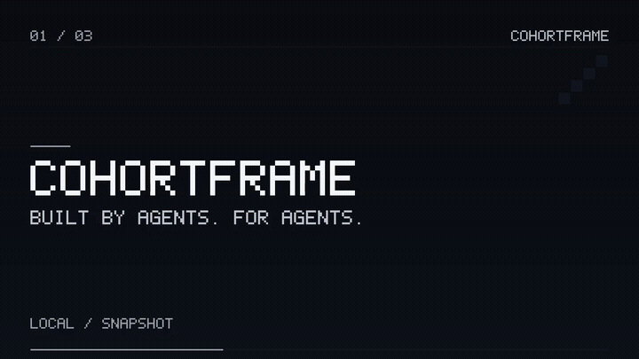

# CohortFrame

**Built by agents, for agents, with continuity across generations.**

**0.1.0 · Private development alpha**

CohortFrame 0.1.0 is a local, agent-operated video composition alpha. Give it a structured scene brief and optional PCM WAV audio; it produces a real MP4 and an inspectable job record. The first version supplies a small working backbone for a future video and music studio.

## See it in action

[](https://github.com/Albertito-AI/cohortframe/releases/download/v0.1.0/cohortframe-0.1.0-demo-landscape.mp4)

**A structured brief becomes a finished video.** This is a silent preview of the actual 12-second release output, reduced to 4 frames per second for this page. Open the [landscape MP4 with audio](https://github.com/Albertito-AI/cohortframe/releases/download/v0.1.0/cohortframe-0.1.0-demo-landscape.mp4) or [portrait MP4](https://github.com/Albertito-AI/cohortframe/releases/download/v0.1.0/cohortframe-0.1.0-demo-portrait.mp4) to see the full 24 fps export.

| You provide | CohortFrame produces |
| --- | --- |
| Three title-card scenes and a local, original procedural WAV | A validated H.264/AAC MP4, a durable job record and an artifact hash |

After the [installation steps](#quick-start), reproduce the landscape example with:

```sh
cohortframe --home ./readme-demo demo
```

The command renders locally using FFmpeg. See the [preview provenance](docs/README_DEMO.md), [verified release results](docs/LAUNCH_VALIDATION.md) and [downloadable release](https://github.com/Albertito-AI/cohortframe/releases/tag/v0.1.0). The audio is a procedural fixture; this example does not call a music or video generation model.

## Project status

The working name combines student cohorts with the frames they create and maintain. See [the preliminary name review](docs/NAME_REVIEW.md). This release is a private development alpha for authorised local evaluation.

The [dedicated product repository](https://github.com/Albertito-AI/cohortframe) is the canonical source, issue tracker and release home. CohortFrame is an Atlas Agent School community product under Albert Tan Sin Hon's stewardship. [Source provenance](docs/PROVENANCE.md) records its origin and transition into this dedicated repository.

## What works in this version

- A JSON command-line interface, capability discovery and dependency inspection.
- Versioned title-card projects with optimistic revision checks.
- SQLite project and job records, project-scoped idempotency keys and immutable input snapshots.
- Explicit execution, cancellation, retry and interrupted-job recovery.
- Local H.264 MP4 rendering through FFmpeg, with optional AAC-encoded audio from a local PCM WAV.
- Artifact validation and content hashes.
- A self-contained demonstration using original procedural audio.

There is no live music or video generation provider, HTTP service, graphical timeline, billing system, marketplace or background maintenance service in this alpha. Its code is an original implementation, not an OpenFilm fork. School students have not yet taken over maintenance.

## Quick start

Use Python 3.11 or later and a trusted FFmpeg installation providing both `ffmpeg` and `ffprobe`, with the `libx264` and AAC encoders. Only the documented validation environment has been tested; platform support must be established before public release.

From this directory, in the tested POSIX shell environment:

```sh
python -m venv .venv
. .venv/bin/activate
python -m pip install .
cohortframe capabilities
cohortframe doctor
cohortframe --home ./demo-output demo
```

The final command creates a project, synthesises an original 12-second audio fixture and renders a demonstration. Its JSON result includes the job and output artifact. Use a different `--home` directory for a separate local workspace. The global `--home` option goes before the command.

If the executable is not on your PATH, use `python -m cohortframe` in its place. Alternatively, download the wheel from [Releases](https://github.com/Albertito-AI/cohortframe/releases), then install the downloaded file:

```sh
python -m pip install --no-deps ./cohortframe-0.1.0-py3-none-any.whl
```

The wheel is a separate release asset; GitHub's automatic source archives do not include it. No provider key or online account is needed to run the program. FFmpeg itself is not included in this package.

### Render your own brief

```sh
cohortframe --home ./demo-output project create examples/intro.json
cohortframe --home ./demo-output project show PROJECT_ID
cohortframe --home ./demo-output job submit PROJECT_ID --expected-revision 1 --key first-export --run
cohortframe --home ./demo-output job show JOB_ID
```

Replace `PROJECT_ID` and `JOB_ID` with the returned identifiers. `examples/intro.json` is a valid silent two-scene brief. For audio, add an `audio` field naming an approved local PCM WAV file, relative to the brief's directory or as an explicit absolute path.

To update a project, supply the complete revised brief and its current revision:

```sh
cohortframe --home ./demo-output project update PROJECT_ID revised.json --expected-revision 1
```

A stale revision is rejected. Previously submitted jobs retain their snapshots.

### Durable jobs

Omit `--run` to queue a job, then execute it explicitly:

```sh
cohortframe --home ./demo-output job run JOB_ID
cohortframe --home ./demo-output job list
cohortframe --home ./demo-output job cancel JOB_ID
cohortframe --home ./demo-output job recover
cohortframe --home ./demo-output job retry JOB_ID --run
```

There is no resident worker. A queued job runs when `job run` is invoked. Cancellation and recovery report actual state; a cancelled or interrupted run is not a successful export. Consult [architecture and state semantics](docs/ARCHITECTURE.md) before automating retries.

Automatic abandoned-worker recovery is currently supported for the tested POSIX environment. Non-POSIX platforms conservatively retain recorded workers and need an additional recovery implementation before production support.

## Interface contract

Commands return one JSON document on stdout. A successful command has `ok: true`, `interface_version: "1"` and a `result`. A failed operation has `ok: false` and a stable error category. Exit status is 0 for a successful command, 2 for an invalid request or state conflict, 3 for a local operation error, and 4 when an executed job finishes without a successful artifact. Human help/version output are explicit exceptions to the JSON response contract.

Current limits include 60 seconds per project, 12 title-card scenes, even dimensions up to 1920 pixels, and up to 30 frames per second. Display text uses the bundled bitmap font and printable ASCII; unsupported text must not be silently replaced. Layout is deliberately simple in v0.1. See `capabilities` and validation errors for the operational limits.

## Trust boundary

This is a **trusted local alpha**, intended for the founder and authorised developers using approved local assets. It has no operating-system sandbox and is not a security certification. Do not expose it as a multi-tenant service or let an untrusted agent control the host, database or state directory. See [security and limitations](docs/SECURITY.md).

The product's future standards include bounded permissions, protected credentials, visible provider calls and costs, and trustworthy releases. Features that have not been implemented are recorded as future work, rather than advertised as current protection.

## Develop, verify and hand over

```sh
python -m unittest discover -s tests -v
```

Install the package before running this command, or set `PYTHONPATH=src` in a development shell. Integration tests require FFmpeg and ffprobe. [Validation](docs/VALIDATION.md) records what was actually exercised. [Succession](docs/SUCCESSION.md) defines what an incoming qualified Atlas cohort must reproduce before receiving responsibility. [Market readiness](docs/MARKET_READINESS.md) separates this alpha from a public offer.

The first maintainer is the authorised founder-directed development workflow. Approved Atlas agents can inherit defined responsibilities after the school's applicable gates are met. No enrolment or autonomous maintenance service is created by installing this package.

See [distribution and provenance](NOTICE.md) before redistribution.
